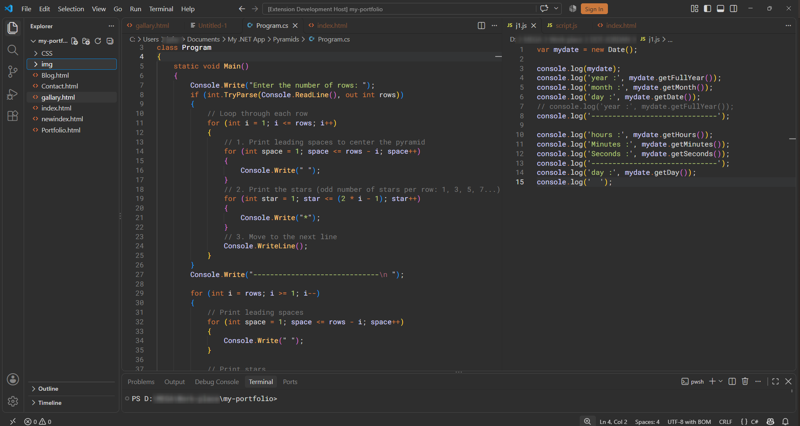

<p align="center">
  
</p>
# Alpenglow Workspace

A flat, warm charcoal dark theme for Visual Studio Code, inspired by the timeless simplicity of Afterglow.

Alpenglow Workspace brings a consistent, distraction-free appearance to the entire VS Code workbench, including the editor, Explorer, tabs, panels, terminal, menus, and notifications.

## Preview



*Alpenglow Workspace running with C# and JavaScript side by side.*


*The soft sunset colors that inspired the theme.*


## Install from source

1. Clone the repository:
   ```bash
   git clone https://github.com/jafar-alshishani/alpenglow-workspace.git
   ```
2. Open the project folder in VS Code.
3. Open the integrated terminal.
4. Install the packaging tool:
   ```bash
   npm install -g @vscode/vsce
   ```
5. Package the extension:
   ```bash
   vsce package
   ```
6. In VS Code, select **Extensions → ... → Install from VSIX...** and choose the generated `.vsix` file.

## Recommended Font

Roboto Mono is recommended for the best visual experience with Alpenglow Workspace.

Suggested VS Code settings:

```json
{
  "editor.fontFamily": "'Roboto Mono', Consolas, 'Courier New', monospace",
  "editor.fontSize": 14,
  "editor.fontLigatures": false
}
```

## Palette

<table>
  <thead>
    <tr>
      <th>Role</th>
      <th>Color Preview</th>
      <th>Hex Code</th>
    </tr>
  </thead>
  <tbody>
    <tr><td>Workspace background</td><td></td><td><code>#2E2E2E</code></td></tr>
    <tr><td>Secondary surfaces</td><td></td><td><code>#262626</code></td></tr>
    <tr><td>Foreground</td><td></td><td><code>#D6D6D6</code></td></tr>
    <tr><td>Orange accent</td><td></td><td><code>#CC7833</code></td></tr>
    <tr><td>Function highlight</td><td></td><td><code>#FFC66D</code></td></tr>
    <tr><td>Green</td><td></td><td><code>#B4C973</code></td></tr>
    <tr><td>Blue</td><td></td><td><code>#6C99BB</code></td></tr>
    <tr><td>Selection</td><td></td><td><code>#5A647E</code></td></tr>
  </tbody>
</table>

## Development

The theme uses VS Code's native `colors` and `tokenColors` contribution points.

## Acknowledgements

**[Afterglow](https://github.com/YabataDesign/afterglow-theme)** by **[José María Clemente (@YabataDesign)](https://github.com/YabataDesign)** was my personal theme in Sublime Text for many years. Its flat design, warm colors, and understated elegance have always made it special to me.

Alpenglow Workspace is my way of bringing that familiar experience to Visual Studio Code, extending its visual philosophy across the entire workspace.

Special appreciation also goes to **[Alpenglow](https://github.com/AlpenglowTheme/alpenglow-theme)**, which carried the Afterglow aesthetic forward.

## License

See the LICENSE file for licensing information.